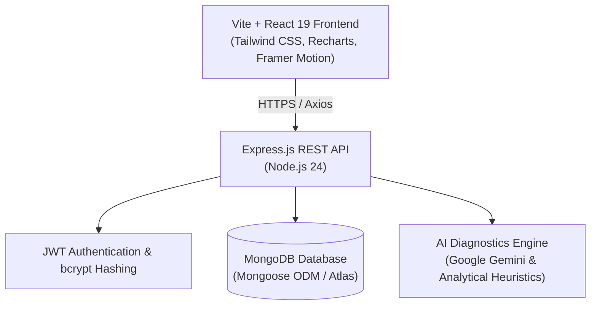

# FinTrack Architecture & Technical Design

## 1. System Overview
FinTrack is an AI-powered personal finance and expense management platform built using modern MERN stack principles and fintech-grade UI/UX paradigms. The platform separates concerns across a decoupled client-server architecture with high security, reactive state management, and real-time financial diagnostics.

## 2. Frontend Architecture
- **Framework**: React 19 via Vite for lightning-fast HMR and optimized asset bundling.
- **Styling**: Tailwind CSS with custom design tokens adhering to the **Minimalist Tech** palette:
  - Deep Space (`#1B262C` - Dominant 60%)
  - Royal Blue (`#0F4C75` - Secondary 30%)
  - Sky Focus (`#3282B8` - Interactive Accent 10%)
  - Soft Cloud (`#BBE1FA` - Highlights & Accents)
- **State Management**:
  - `AuthContext`: Manages user credentials, JWT session token, profile, and automatic logout upon expiry.
  - `FinanceContext`: Coordinates real-time sync across transactions, budgets, summary metrics, and analytics without redundant re-fetching.
- **Routing**: `react-router-dom` with role-isolated `ProtectedRoute` guards and persistent sidebar layout.
- **Visualizations**: `recharts` responsive charts featuring smooth easing animations and custom tooltips.

## 3. Backend Architecture
- **Runtime**: Node.js v24 with Express.js.
- **Design Pattern**: Controller-Service-Repository pattern.
- **Security Protocols**:
  - `helmet`: Secure HTTP response headers.
  - `cors`: Strict origin whitelisting.
  - `express-rate-limit`: Brute-force mitigation on authentication and AI advisor routes.
  - `bcryptjs`: Adaptive one-way salted password hashing.
  - **Ownership Invariance**: User ID is never accepted from client payload; it is strictly injected from the verified JWT payload (`req.user._id`).
- **Database Engine**: MongoDB with Mongoose ODM.
  - Supports MongoDB Atlas URI.
  - Embedded `mongodb-memory-server` fallback for zero-friction local development without requiring local database daemon installation.

## 4. AI & Financial Intelligence Layer
- **Gemini 1.5 Flash Integration**: Analyzes user-specific cashflow data and answers conversational personal finance inquiries.
- **Algorithmic Fallback Engine**: If no API key is supplied, FinTrack executes a multi-factor financial health score calculation (savings rate, 50/30/20 compliance, category concentration, budget overrun detection).
